# Architecture and decision model

## Runtime

```mermaid
flowchart LR
  UI[React dashboard :5173] --> API[FastAPI :8000]
  API --> AUTH[Local hashed bearer identity + tenant + RBAC]
  AUTH --> POLICY[Enabled immutable active snapshot]
  POLICY --> INPUT[Secret / PII / redaction / moderation / keywords]
  INPUT --> GATE{Input decision}
  GATE -->|ALLOW or revalidated REDACT| MODEL[Azure OpenAI provider]
  GATE -->|BLOCK or HUMAN_REVIEW| HOLD[Withhold content]
  MODEL --> OUTPUT[Same snapshot: output inspection]
  OUTPUT --> RELEASE{Output decision}
  RELEASE -->|ALLOW or revalidated REDACT| SAFE[Safe response]
  RELEASE -->|BLOCK or HUMAN_REVIEW| HOLD
  SAFE --> AUDIT[Commit sanitized execution and audit]
  HOLD --> AUDIT
  AUDIT --> SQL[(SQLite or Azure SQL)]
  SQL --> EXPORT[Metadata allowlist export]
  EXPORT --> ADLS[Existing ADLS Gen2 filesystem]
```

Generation uses a dedicated provider interface expressed as the async `generate_ai_response()` function. Fixture mode replaces remote generation and moderation, but not policy lifecycle, gateway enforcement, SQL persistence, or real Presidio when selected. No provider is called directly by the frontend. No unapproved cloud services or cloud hosting are used.

Code ownership boundaries: `schemas.py` validates versioned JSON and request/response contracts; `engine.py` performs deterministic inspection; `providers.py` owns HTTP and Azure SDK calls; `security.py` resolves local identities; `models.py` owns relational records; `database.py` owns transactions; `main.py` handles authenticated API orchestration and queries. The query helpers are intentionally small rather than a generalized repository framework.

## Policy lifecycle

A policy has a mutable draft and zero or more immutable versions. Submit requires DRAFT; Approve requires SUBMITTED; Publish requires APPROVED. Any edit resets to DRAFT and increments revision. Publishing stores a complete JSON snapshot with a monotonically increasing per-policy version number. The existing active snapshot remains unchanged when its policy draft changes. Activation selects the newest enabled published version for the authenticated tenant. Disabling the active policy makes effective resolution fail closed. Activating another version is required before archiving an active policy. Only never-published DRAFT policies can be deleted.

An optimistic `row_version` prevents concurrent updates from approving a stale draft. The unique policy/version constraint protects concurrent publication. A review decision cannot change its original execution; the immutable audit trail records its disposition. There is no direct REST mutation route for versions or audit events. ORM history hooks reject updates and deletes; these hooks are not a substitute for production database write privileges or tamper-evident audit storage.

## Governance decisions

Precedence is BLOCK > HUMAN_REVIEW > REDACT > ALLOW. Secret and PII detectors return spans, not sensitive matched values. Presidio email validation uses bundled domain-suffix data with network retrieval disabled; the installed NLP model is never downloaded at inspection time. Enabled keyword rules use literal case-insensitive matching, not user-provided regex. Secret/PII/keyword redaction merges overlapping spans and inserts `[REDACTED]`. A second complete inspection must return ALLOW before sanitized content is released or sent to generation. Revalidation cannot recursively redact forever. Moderation redaction is rejected by schema because the API does not provide trustworthy toxic-content spans.

Existing BLOCK or HUMAN_REVIEW findings prevent external moderation of the held text. That unperformed control is UNKNOWN, never successful. Required detector exceptions and moderation errors produce UNKNOWN and a non-releasing BLOCK. Disabled controls are NOT_APPLICABLE. Unknown policy, disabled active policy, malformed provider responses, invalid schemas, and missing configuration do not silently allow content.

A request loads one immutable snapshot and uses it across input and output even if another policy activates during generation. Generation occurs only for ALLOW or successfully revalidated REDACT input. The response is withheld until output inspection passes **and the execution audit transaction commits**. A provider outage produces a persisted BLOCK with no safe response. Overall REDACT is retained when input was sanitized and output is allowed, so metrics reflect the protected interaction.

## Explainable weighted score

| Control | Weight |
|---|---:|
| Secret detection | 30 |
| PII detection | 25 |
| Moderation | 25 |
| Enterprise keywords | 20 |

Score = 100 × satisfied weight ÷ applicable weight. SATISFIED earns its weight; FAILED and UNKNOWN earn zero. NOT_APPLICABLE removes the weight from numerator and denominator. If every control is disabled, score is 0 rather than an invented compliance success. Initial violations remain FAILED in the initial result even after successful redaction; `revalidated=true` explains why sanitized content may be released. The score never changes a BLOCK or HUMAN_REVIEW decision. It measures configured heuristic control outcomes, not legal or regulatory compliance.

## Database schema

The actual demonstration uses eight feature tables (not empty suggested tables). Local users, organization membership, roles, and tenant context are provisioned in the private server environment; they are not editable user tables.

| Table | Main fields | Integrity and use |
|---|---|---|
| policies | id, tenant, name, draft, status, enabled, revision, row_version | tenant index, optimistic concurrency |
| policy_versions | id, policy_id, tenant, number, document, created | policy FK, unique policy+number, append-only |
| active_policy_assignments | tenant, version_id | one tenant assignment, version FK |
| validation_executions | id, tenant, actor, policy_id, version, model, decision, metadata_json, created | sanitized metadata, tenant/decision indexes |
| audit_events | id, tenant, actor, action, resource, created | append-only lifecycle/enforcement events |
| human_review_cases | id, tenant, execution_id, status, created | execution FK, metadata-only review |
| feedback_records | id, tenant, execution_id, rating | tenant-checked execution FK, numeric-only feedback |
| evaluation_exports | id, tenant, status, path, created | actual attempt outcomes, sanitized exports |

Alembic additionally maintains its `alembic_version` metadata table. Policy drafts and approval evidence use policy fields and append-only events rather than separate unused tables. Executions store historical policy identifiers without deleting audit evidence when a draft is removed. Cross-tenant references are rejected in authenticated service queries; compound tenant foreign keys and database row-level security are future hardening. SQL Server DDL compilation and fresh SQLite migrations are tested separately. Live SQL Server migrations are blocked by credentials/access.

## Authentication and authorization

Credentials are randomly generated local bearer tokens; only SHA256 hashes are loaded into backend identity mappings. The plaintext local token handoff file is private and ignored by Git. There is no hardcoded credential, frontend role trust, or anonymous governance endpoint. Health endpoints are anonymous but expose no secrets.

| Operation | Authorized roles |
|---|---|
| Read tenant policies, executions, analytics | All authenticated roles |
| Create/edit/delete/submit/publish/activate/enable/disable/archive | Admin, Policy Owner |
| Approve policy | Admin, Reviewer |
| Validate/generate | Admin, Policy Owner, Developer |
| Read review metadata | Admin, Reviewer, Auditor |
| Resolve review | Admin, Reviewer |
| Export reports/list attempts | Admin, Auditor |
| Numeric feedback | Authenticated users with a tenant-owned execution |

Tenant identity is never accepted as a request field or trusted header. All list operations use authenticated tenant predicates. Error responses avoid raw SQL exceptions and Pydantic input reflection. The bounded request middleware caps bodies at 64 KB even without a Content-Length header; text input is separately capped at 12,000 characters. CORS is restricted to the configured local frontend. SQLAlchemy uses bound query parameters. Docker binds ports to loopback and uses unprivileged users.

## Human review scope

Reviewers see only sanitized execution metadata and control findings, not the original content. Approval produces `APPROVED_RESUBMIT_REQUIRED`, rejection produces REJECTED. The state change and immutable audit event share a transaction. Repeated dispositions return 409. There is no release/resume endpoint: approval cannot bypass generation or output gates. A revised prompt must be submitted again under the current effective policy. Automatic replay would require encrypted held-content storage, retention/expiry, reviewer content authorization, single-use approval binding, revalidation, and output inspection. Those capabilities are not implemented.

## Operational and privacy boundaries

Ordinary audit storage and exports omit raw prompts, responses, secrets and matched substrings. Audit storage contains identifiers and timestamps, so still requires controlled access and retention governance. ADLS export uses only request ID, time, decision, policy ID and version; it does not dump arbitrary audit JSON. Failed export attempts remain visible.

The API is synchronous for ADLS SDK work in a threadpool handler. HTTP providers have bounded timeouts; retry/backoff, provider circuit breakers, durable export outboxes, production retention, secret rotation, per-tenant rate limits, enterprise SSO, and tamper-evident audit chains are future work. No hallucination evaluation, comprehensive bias scoring, GDPR certification, or HIPAA certification is implemented or claimed.
