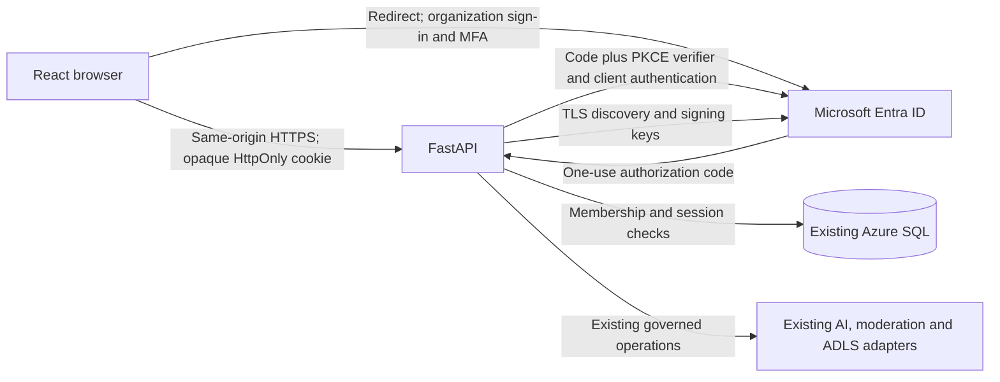

> **Superseded candidate design:** The later [compatibility release](SSO_COMPATIBILITY_RELEASE.md) preserves production demo login until SSO acceptance and supports reviewed schemas 004/005. Statements below about an SSO-only production UI or mandatory 005 describe the earlier candidate. Historical test evidence is retained.

# Microsoft Entra ID SSO candidate — Governance Studio

Prepared 4 November 2026 (Asia/Kolkata). This is a locally implemented, **undeployed candidate**. The existing hosted application has not been changed. Do not claim real Microsoft sign-in has passed. See `ENTRA_SSO_REPORT.md` for final validation counts and the full file inventory.

## What this changes

SSO means users sign in through their organization's identity provider instead of handling application credentials. Microsoft Entra ID authenticates the account and applies the organization's existing MFA and conditional-access rules. Governance Studio then separately checks whether that identity is authorized for a workspace and role. A successful Microsoft sign-in alone never grants application access.

The previous application login used opaque bearer credentials, not JWTs. That API compatibility path remains separate. No enterprise JWT API endpoint previously existed to preserve. Microsoft ID tokens are accepted only as the result of a server-to-server authorization-code exchange, never as arbitrary browser API bearer credentials.

## Architecture and trust boundaries



The browser is untrusted. It cannot supply a trusted role, tenant, object identifier or user name. The client secret and Microsoft tokens stay inside FastAPI. Only an opaque random session identifier is placed in an HttpOnly cookie. Database storage contains the session identifier's SHA-256 hash, not a usable bearer credential. The database and its separately authorized provisioning operator are trusted to maintain membership mappings. Application runtime gets SELECT, not membership-write permission.

```mermaid
sequenceDiagram
  participant B as React/browser
  participant F as FastAPI
  participant E as Entra ID
  participant D as Azure SQL
  B->>F: GET /api/sso/login?return_to=/policies
  F->>D: Save five-minute one-use state, binding, nonce, verifier
  F-->>B: Secure transaction cookie; redirect with PKCE challenge
  B->>E: Authenticate, including organizational MFA when required
  E-->>B: Redirect with code and state
  B->>F: GET /api/sso/callback
  F->>D: Verify binding/expiry; atomically consume transaction
  F->>E: Exchange code with client credential and PKCE verifier
  E-->>F: Signed ID token
  F->>E: Fetch tenant-pinned discovery/JWKS
  F->>F: Validate signature, issuer, audience, expiry, nonce and directory
  F->>D: Resolve enabled tid + oid membership
  F->>D: Create hashed application session and audit event
  F-->>B: Secure HttpOnly session cookie; redirect to approved route
  B->>F: GET /api/sso/me
  F->>D: Check session and current membership
  F-->>B: Approved identity, workspace, role and CSRF value
```

## Actual code and endpoints

`backend/app/sso.py` contains the router:

| Endpoint/function | Behavior |
|---|---|
| `GET /api/sso/status`, `status()` | Safe enablement/configuration booleans; no credentials or IDs. Configuration presence does not prove registration or database readiness. |
| `GET /api/sso/login`, `login()` | Checks configuration and safe return route, applies a SQL-backed global 120/minute initiation bound, creates a transaction, and uses Authlib to produce an S256 PKCE authorization request. |
| `GET /api/sso/callback`, `callback()` | Verifies state-bound cookie and expiry, atomically consumes the transaction before code exchange, authorizes membership, rotates an old session and creates an audit event. Failure redirects show only fixed safe error codes. |
| `exchange_code()` | Authlib confidential-client exchange; joserfc RS256 signature verification; Authlib `CodeIDToken.validate()` checks registered claims, nonce, authorized party and access-token hash when present. Validated directory and object IDs identify membership. |
| `metadata()` | HTTPS discovery pinned to the configured directory's exact issuer. Credential/code/JWKS endpoints must use `login.microsoftonline.com`; redirects are not followed. Signing keys are freshly obtained for each login. |
| `cookie_identity()` | Every protected request rechecks session expiry/revocation and current enabled membership. It checks CSRF plus exact Origin for mutations. |
| `GET /api/sso/me`, `me()` | Restores identity after refresh and returns CSRF material; no Microsoft tokens. |
| `POST /api/sso/logout`, `logout()` | Revokes the application session transactionally, clears its cookie, then supplies the tenant-specific Microsoft logout URL. |
| `GET /api/sso/sessions`, `sessions()` | Admin-only, workspace-scoped, paginated session metadata. |
| `POST /api/sso/sessions/{id}/revoke`, `revoke_session()` | Admin-only workspace-scoped revocation with CSRF and audit. |
| `configuration()` / `safe_return_path()` | Validate secure deployment configuration and allow only existing relative SPA routes. Queries/fragments are deliberately omitted. |

`backend/app/security.py::authenticate()` routes cookie requests into `cookie_identity()`. Cookie plus bearer authentication is rejected rather than combining identities or falling back after failure. Existing API credentials and demo sessions keep their prior server-owned authorization rules.

`frontend/src/main.tsx::App()` restores a session with `/api/sso/status` and `/api/sso/me`. Its Microsoft button navigates to `frontend/src/api.ts::loginUrl()`. `request()` uses `credentials: include` and adds an in-memory CSRF value. The frontend displays user, role and workspace, handles expiry and fixed callback errors, and reports an unconfirmed logout without claiming the server session was revoked. Production does not use browser token storage. The input-token UI is only reachable when Vite is in development mode **and** `VITE_DEMO_LOGIN=true` is explicitly supplied; it cannot be enabled in a production build with that flag.

`backend/app/main.py::assign_review()` resolves SSO reviewer eligibility from enabled `SsoMembership` rows in the same directory/workspace. Demo callers retain their separate demo account lookup. Existing governance decisions, tenant filters, review disposition rules, provider gates and release rules are unchanged.

## Configuration and registration

The read-only lookup of `Governance-Studio-SSO` returned **zero matches** in directory `4ac50105-0c66-404e-a107-7cbd8a9a6442`, using the existing project-local Azure CLI user identity. This is an observation, not authorization to create a registration or reuse another registration. Confirm that directory and operator authority before provisioning. No client ID or client secret was created or invented. No registration, consent, tenant policy or App Service setting was changed.

| Setting | Required value/purpose |
|---|---|
| `SSO_ENABLED` | Default `false`; enable only after approval gates. |
| `ENTRA_TENANT_ID` | Explicit approved single-directory UUID, independently confirmed for this app. |
| `ENTRA_CLIENT_ID` | Actual Application (client) ID of the reviewed registration; currently unavailable. |
| `ENTRA_CLIENT_SECRET` | Server-only confidential Web client credential. Securely provision through existing approved App Service configuration; never use a `VITE_` variable, CLI output, source or chat. Currently unavailable. This implementation uses a secret, not a certificate. |
| `SSO_PUBLIC_ORIGIN` | `https://app-governance-validator-atiya-1026.azurewebsites.net`, without trailing slash. Fixed configuration avoids trusting proxy Host headers. |
| `CORS_ORIGIN` | Same exact HTTPS origin for hosted SSO; production uses same-origin requests. |
| `SSO_SESSION_MINUTES` | Default 120; range 5–120 (shorter operator limits are honored). Absolute application expiry; no refresh token or rolling extension. |
| `DEMO_BROWSER_LOGIN_ENABLED` | Default `false`; must remain false for hosted SSO. Reports development demo availability; it does not grant API roles. |
| `VITE_API_URL` | `/` for production and same-origin HTTPS local SSO. Build-time frontend setting. |
| `VITE_DEMO_LOGIN` | Omit for SSO. Explicit `true` only for development fixture/token workflows. |

Derived issuer: `https://login.microsoftonline.com/<approved-tenant-uuid>/v2.0`.

Derived discovery: `<issuer>/.well-known/openid-configuration`.

Audience: the exact reviewed `ENTRA_CLIENT_ID`. JWKS: obtained from pinned discovery, with Microsoft's HTTPS hostname enforced. Accepted ID-token signing algorithm: RS256 only. The application creates no Microsoft signing key and needs no private JWT signing key.

Register the **Web** platform callback, not an SPA callback:

`https://app-governance-validator-atiya-1026.azurewebsites.net/api/sso/callback`

This replaces the proposed `/auth/callback` path consistently. The backend registers the route before its SPA fallback; NGINX also forwards `/api/` correctly. Register the intended HTTPS local origin's `/api/sso/callback` separately if real local Microsoft login is approved. Use the same origin for local frontend/API, with an approved trusted TLS certificate or existing TLS development proxy. Plain HTTP development is intentionally unsupported for SSO because `__Host-` cookies require Secure. Keep the existing offline HTTP demo separate.

Request only `openid profile`. No Microsoft Graph API call, `User.Read`, broad application permission, offline access or automatic administrator consent is needed by this implementation. Do not alter organization-wide MFA or conditional-access policy. If tenant policy requires consent or assignment, an authorized administrator must complete that specific operation.

Authlib and Microsoft's primary documentation: [Authlib web clients](https://docs.authlib.org/en/latest/oauth2/client/web/), [Microsoft ID tokens](https://learn.microsoft.com/en-us/entra/identity-platform/id-tokens), [Microsoft claim validation](https://learn.microsoft.com/en-us/entra/identity-platform/claims-validation). Protocol implementation is delegated to maintained libraries; application code supplies the explicit trust and authorization policy.

## Membership and authorization

No existing user/membership tables existed: demo identities lived in server-side JSON. Additive migration `backend/migrations/versions/005_entra_sso.py` creates:

- `sso_memberships`: Entra directory/object UUID → existing application tenant, stable actor, approved role, enabled flag. Unique directory/object and unique workspace/actor constraints prevent ambiguous mappings. One mapped application workspace per Entra identity in this version.
- `sso_transactions`: hashed state and browser binding, server-side nonce and PKCE verifier, safe return path, five-minute expiry, consumed flag. Database confidentiality and restricted runtime permissions protect the temporary verifier. Expired/consumed rows cannot authenticate.
- `sso_sessions`: hashed cookie credential, membership foreign key, expiry and revoked flag. No Microsoft tokens are stored.

Use `scripts/manage_sso_membership.py::validate_mapping()` / `apply_mapping()` only as a separately authorized operator. Start from `deployment/sso-membership.example.json`. It is deliberately disabled and contains placeholders that fail validation. Fill the **approved non-secret identifiers** through operator tooling, not guessed emails or browser parameters. The `actor` can match an existing application actor only with explicit approval, preserving review/audit ownership. Assigning Admin requires an explicit approved mapping; no initial user is automatically privileged.

The default command validates and plans without opening a database:

```bash
.venv/bin/python scripts/manage_sso_membership.py --mapping /approved/path/membership.json
```

After approval for the exact directory, identity, workspace, actor and role, the operator may use `--apply --operator <approved-operator> --approval-ref <change-reference>`. This tool writes membership and `sso.membership.provisioned` audit in one transaction. It cannot silently move an existing identity to another actor/workspace. An approval reference records authorization; it does not itself prove authority. Runtime HTTP endpoints cannot provision memberships.

Unknown/disabled identities and wrong directories are denied. Every request uses the current membership role/workspace; role change and disable take effect on the next request after the operator transaction commits. Already-running requests may finish. For role reductions or urgent disable, revoke sessions as part of the approved operation. SQL-backed sessions work across workers without Redis or sticky affinity; every worker must share configuration and database.

## Session security and errors

Session and transaction cookies use `__Host-` names, Secure, HttpOnly, SameSite=Lax, Path=/, and no Domain. Lax permits the top-level GET OIDC callback. Session cookies have a bounded lifetime and the database independently enforces expiry. A new login generates a new session and revokes the previous cookie's session. No Microsoft access/refresh token reaches localStorage/sessionStorage or JSON responses.

For mutations, FastAPI requires both the exact configured HTTPS Origin and an `X-CSRF-Token` derived from the HttpOnly session secret. `/me` supplies the CSRF value into React memory. A different origin cannot read that response. Invalid/missing authentication returns 401, permission/CSRF denial 403, unconfigured SSO 503. Provider errors produce fixed messages and never reflect authorization codes, secrets or token claims.

Current structured application logs include route templates/status, not queries or request bodies. Production startup already uses `--no-access-log`. The callback carries a one-use code in its URL; the reverse proxy/App Service HTTP logging configuration must be reviewed to avoid recording callback queries before live acceptance. Do not enable verbose HTTP/OAuth logging. SQL sessions/audits are not Microsoft tokens, and database access remains restricted. HTTPS and the fixed public origin handle Azure reverse-proxy behavior without trusting forwarded host headers.

Logout revokes the application session before Microsoft sign-out navigation. An unavailable Microsoft logout page does not restore that session. Microsoft-wide sign-out behavior and conditional access still require real organizational acceptance. There is no background Microsoft refresh flow; after app expiry the user signs in again, subject to Microsoft's remaining organizational session.

Expired SSO operational rows are retained in this candidate; they do not become usable again. Plan separate approved cleanup under the existing retention/operations process rather than granting runtime DELETE. Existing business audits are preserved.

## Local verification and safe deployment

Run existing backend tests from `backend/` using `../.venv/bin/python -m pytest -q`. Tests use disposable databases and synthetic OIDC responses. This environment requires the existing approved outside-sandbox TestClient execution because TestClient hangs inside the restrictive sandbox.

Run frontend `npm test`, `npm run lint`, and `npm run build`. Set `GOVERNANCE_TEST_PYTHON` to the existing project Python executable to include the opt-in real disposable backend integration. New frontend SSO tests live in `frontend/src/Sso.test.tsx`; legacy tests explicitly opt into the development login flag.

For Chrome acceptance, first build React with `VITE_API_URL=/` and no demo flag. Run `scripts/tests/sso_browser.cjs` with an available Playwright Core module and Chrome. It launches `backend/tests/sso_browser_server.py`, which uses a new temporary SQLite database, a test-only HTTPS certificate, and a **mocked identity provider**. Those test patches and the test provider are never included in the deployment package. Browser success proves browser/application behavior, not Microsoft account authentication. Backend tests separately verify cryptographic token rejection with synthetic RSA keys.

Do not use ordinary `docker compose up` for this task: its existing startup runs migrations. No hosted migration has been performed. Source migration head is now 005; the previously hosted release uses 004 according to recorded repository evidence, not a fresh SQL inspection in this task. `deployment/migration-005.REVIEW_ONLY.sql` is offline SQL Server compilation, not executed migration proof.

Deployment gates, in order:

1. Confirm directory/operator and intended registration; create/reuse only with authority. Securely provision its confidential-client credential; register the exact Web callback and logout return URL.
2. Approve each identity/workspace/role mapping. No Admin mapping is inferred from the current Azure CLI identity.
3. Review migration 005 and current SQL state, recovery-point availability, restore rehearsal and rollback target. Obtain explicit approval for the exact hosted database operation. The additive migration has no destructive automatic downgrade.
4. Review `deployment/sso-runtime-permissions.REVIEW_ONLY.sql`; runtime needs SELECT on membership and SELECT/INSERT/UPDATE on transaction/session tables, plus existing audit/rate-bucket permissions. Only a separate operator may write memberships. Review new permissions before applying them.
5. After approved migration/grants and membership provisioning, configure the existing App Service only: reviewed Entra values, fixed HTTPS origin, SSO enabled, development demo disabled. Verify presence without printing values. No new Web App, database, Key Vault or Redis is required.
6. Review the packaged candidate's exact release fingerprint, source diff, dependency lock, tests, configuration plan and rollback package. Obtain **specific release/environment deployment approval**. Never deploy an incompletely configured candidate.
7. After approval, deploy using existing authorized tooling. Check public health/readiness and fingerprint; readiness requires migration 005. Perform a real Microsoft login with an approved human account, verify role/workspace and a safe policy GET, refresh, logout, repeat login, unauthenticated denial and safe logging. No paid AI/moderation/export test is included.

A candidate ZIP can be created locally with `scripts/prepare_app_service.py --frontend-dist frontend/dist --output <new-artifact.zip>`. The builder allowlists application Python, locked requirements, startup and production static assets; it includes neither environment files, membership inputs, databases, tests nor Microsoft credentials. Migration/grant artifacts are separate, review-only inputs. Packaging is not permission to deploy and does not make missing configuration valid.

## Rollback

Before rollout, retain the actual previous deployed ZIP/fingerprint and securely record the previous approved App Service settings without printing credentials. Confirm that package works against SQL 005 in a recovery rehearsal. The migration adds isolated tables and changes no governance rows, but the old release's `/ready` expects 004. **Do not assume an old package is ready against 005.**

Preferred reviewed rollback: restore a prevalidated compatibility build of the previous application that accepts the additive schema version while retaining old authentication; obtain release approval for that package too. Alternatively, use the explicitly approved database recovery plan to return to the pre-change schema/time and restore the original package/settings, accounting for data written since the recovery point. No such hosted recovery is authorized here. Never edit Alembic history to disguise a mismatch, drop session/audit tables, disable validation, or modify hosted data to make readiness pass.

Reverting just `SSO_ENABLED=false` on this candidate does **not** restore a production token-entry screen: production token login is intentionally unavailable. A full approved package/configuration rollback is needed. Disable the SSO setting and remove its credential only within the reviewed rollback change. Retain additive identity/session evidence unless separately authorized retention cleanup applies. No rollback command has been run.

## Architect interview questions and answers

**What is the difference between authentication and authorization?** Entra proves which organizational identity signed in. Governance Studio's membership row decides which workspace and role it may use.

**Why authorization code instead of passing tokens through React?** The browser transports a short-lived one-use code. FastAPI exchanges it with its client credential and verifier, so Microsoft tokens remain on the server.

**What does PKCE do?** The login request carries a challenge derived by Authlib from a private verifier. Code exchange must supply that verifier, limiting use of an intercepted code.

**Why both state and nonce?** State binds the callback to this browser's one-use login transaction. Nonce binds the returned signed identity token to that transaction. They address different substitution/replay risks.

**Why use tid and oid instead of email?** Directory and object identifiers are stable identity keys. Email can change and does not establish application membership.

**Where are signing keys?** Microsoft holds the private key. FastAPI retrieves public JWKS through tenant-pinned HTTPS discovery and accepts only RS256 signatures for its own client audience.

**Why a database session if an ID token exists?** The app can revoke its own session immediately and recheck membership on each request, without exposing Microsoft tokens to the browser or adding infrastructure.

**How do multiple workers agree about logout?** They all read the same SQL session row and current membership. A committed revocation is visible to the next request.

**How is CSRF prevented?** Mutations require the app's exact Origin and an unpredictable session-derived header value, in addition to the HttpOnly cookie.

**Can an organizational user become Admin automatically?** No. Unknown identities are denied; Admin requires a separately approved, audited membership mapping.

**Does a passed mock login prove enterprise SSO works?** No. It tests application behavior and rejection rules. Registration, tenant policy, credential, TLS/proxy configuration and a real human Microsoft flow must pass live acceptance separately.

**What remains unchanged?** Existing policy enforcement, role checks, workspace query filters, AI inspection gates and provider adapters. SSO supplies the same server-controlled `Identity` shape those functions already use.
